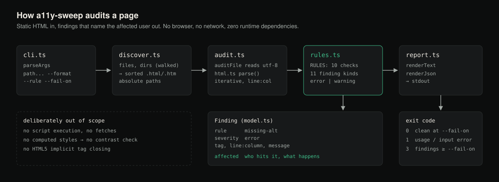

# a11y-sweep

Audit static HTML for accessibility defects — with findings that name the
**affected user and what happens to them**, never just the failing rule.
Zero runtime dependencies.



Real output from the bundled fixture, restricted to two rules (each file is reported by
its absolute path; shown here as `<clone>`):

```console
$ a11y-sweep fixtures/example.html --rule missing-alt --rule unlabelled-form-control
<clone>/fixtures/example.html
  ERROR   [missing-alt] 7:3   has no alt attribute at all
            a screen reader user hears only 'image' (or the raw file name), with no idea what the image shows or why it is there
  ERROR   [unlabelled-form-control] 14:5 <input> <input> has no associated <label>, aria-label, aria-labelledby, or title
            a screen reader user tabbing into this field hears only its type ('edit text', 'combo box'), with no idea what information to enter
$ echo $?
3
```

## Status

Version 0.1.0, not published to npm. CI runs the test suite on Ubuntu, Windows and macOS
with Node 20, 22 and 24, plus typecheck, lint, coverage, and a dogfood job asserting that
exactly the documented findings fire on `fixtures/example.html`. Evidence and known gaps:
[docs/PRODUCTION_READINESS.md](docs/PRODUCTION_READINESS.md).

## Prerequisites

Node.js >= 20 (`engines`) and npm. Nothing else at runtime.

## Install

a11y-sweep is not published to the npm registry; install it from a clone:

```console
git clone https://github.com/hellpuffyt/a11y-sweep
cd a11y-sweep
npm ci && npm run build
npm link        # puts `a11y-sweep` on your PATH (or run node bin/a11y-sweep.js)
```

## Why "affected user", not "rule name"

"img missing alt" tells you what to fix but not why it matters, and a
message that only restates a rule's name gets ignored the second time it's
seen. Every finding here names the *consequence*: who runs into it (a
screen reader user, a keyboard-only user, someone relying on the tab order)
and what actually happens to them. `affected` is a first-class field in
both the text and JSON output.

## The ten checks

| Rule | Severity | Catches |
|---|---|---|
| `missing-alt` | error | `` with no `alt` attribute at all |
| `unlabelled-form-control` | error | `<input>`/`<select>`/`<textarea>` with no `<label>`, `aria-label`, `aria-labelledby`, or `title` |
| `link-text` | error / warning | `<a href>` with no accessible text (error, reported as `empty-link`), or only "click here"/"read more" (warning, reported as `vague-link-text`) |
| `heading-hierarchy-skip` | warning | `<h1>` → `<h3>` skipping a level |
| `missing-lang` | error | `<html>` with no `lang` attribute |
| `keyboard-unreachable-interactive` | error | an `onclick` handler on an element with no keyboard role/focus |
| `missing-title` | error | no `<title>`, or an empty one |
| `table-missing-headers` | error | a data table (its own `<td>`s) with no `<th>` of its own |
| `duplicate-id` | error | an `id` used more than once (breaks `for`/`aria-labelledby`) |
| `iframe-missing-title` | warning | `<iframe>` with no `title` |

No rule currently emits `info`; `--fail-on info` therefore behaves like `--fail-on warning`.

### What is *not* reported

Each rule follows the accessible-name rules a browser uses, so these are
treated as correct (see `fixtures/negatives/` — the test suite asserts they
produce zero findings):

- elements removed from the accessibility tree (`aria-hidden="true"`,
  `hidden`), and images marked decorative (`role="presentation"`/`"none"`);
- a non-blank `aria-label`/`aria-labelledby` in place of `alt`, a `<label>`,
  link text or an iframe `title`; `title` as a form control's or empty
  link's last-resort name; a link whose only content is a named `<svg>`;
- `<input type="hidden|submit|reset|button|image">` (named by `value`/`alt`);
- `onclick` on natively interactive or delegating elements (`<summary>`,
  `<label>`, `<body>`, ...) or on an element with any ARIA widget role
  (`tab`, `checkbox`, `menuitem`, ...) plus `tabindex >= 0`;
- layout tables (`role="presentation"`/`"none"`), and `missing-title` on a
  partial with no `<html>` element; a `<title>` inside `<svg>` does not
  count as the page title.

Blank attribute values (`aria-label="  "`, `title=""`) never count as a
name, and character references are decoded first (`&nbsp;` alone is empty
link text).

## Usage

```console
a11y-sweep page.html other/                # files and directories mix freely
a11y-sweep site/ --format json              # machine-readable, same content
a11y-sweep page.html --rule missing-alt     # one check only (repeatable)
a11y-sweep page.html --fail-on warning      # stricter CI gate
a11y-sweep page.html --fail-on never        # report only, always exit 0
a11y-sweep --list-rules
a11y-sweep --version
```

A directory is walked recursively for `.html` and `.htm` files; a file argument must
have one of those extensions. Files are audited in sorted order and reported by absolute
path.

`--format json` prints an array with one entry per file:
`{ "file", "findings": [{ "rule", "severity", "tag", "line", "column", "message", "affected" }] }`.

Exit codes: `0` clean at the chosen threshold (default `error`), `1` bad
input or usage (including an unknown `--rule` name), `3` findings at or
above `--fail-on`.

## What it deliberately does not do

- **No color contrast checking.** Contrast is a *computed-style* problem —
  it needs a CSS engine, not a static HTML parser — and a tool that faked
  it from inline styles alone would produce confidently wrong results.
- **Not a full HTML5 parser.** There is no implicit tag-closing (`<p>`
  auto-closing on the next `<p>`); malformed input degrades gracefully
  rather than crashing, but this tool assumes reasonably well-formed,
  explicitly-closed HTML — which is what templating engines and static
  site generators actually emit.

## Library API

The package also exports its pieces (`dist/index.js`, ESM with type declarations):
`auditFile(path, rules?)`, `auditSource(name, html, rules?)`, `discover(paths)`,
`renderText`/`renderJson`, `RULES`/`runRules`, and the parser (`parse`, `walk`,
`findFirst`, `textContent`). See [`src/index.ts`](src/index.ts).

## Security

a11y-sweep only reads the files you point it at; it never executes scripts
in them or fetches anything. The parser is iterative and linear-time, so
deeply nested or very large documents cannot overflow the stack. Please
report vulnerabilities privately as described in [SECURITY.md](SECURITY.md).

## Development

```console
npm ci
npm test
npm run typecheck
npm run lint
npm run build       # emits dist/, which bin/a11y-sweep.js imports
npm run coverage
```

See [CONTRIBUTING.md](CONTRIBUTING.md) for the ground rules (zero runtime dependencies,
every rule names the affected user).

## License

MIT — see [LICENSE](LICENSE).
